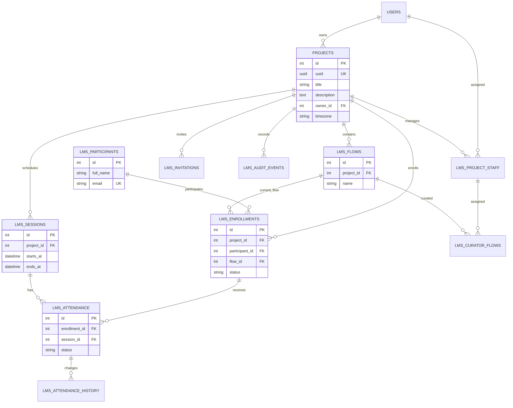

# Мини-LMS — итоговая архитектура MVP

> **Статус:** согласованная концепция, реализация поэтапная.  
> **Цель:** заменить Excel в работе с образовательными проектами: списками слушателей, потоками, расписанием, посещаемостью и отчётами.

В MVP разрабатываем **административный кабинет**. Личные кабинеты слушателей, самостоятельная регистрация и образовательный контент пока не входят в область реализации.

## 1. Основные архитектурные решения

| Компонент | Решение |
|---|---|
| Backend | Существующий FastAPI (`api-backend`) |
| База данных | Общая PostgreSQL 18 |
| ORM | SQLAlchemy 2.0, async |
| Миграции | Общая цепочка Alembic |
| Frontend | Jinja2 + Bootstrap 6 |
| Авторизация сотрудников | Существующая `User` и общая система аутентификации |
| Образовательные проекты | Существующая `Project`, полностью переориентированная на LMS |
| Слушатели | Отдельный глобальный справочник `LmsParticipant` |
| Участие в проектах | `LmsEnrollment` |
| Личные кабинеты слушателей | Не реализуем в MVP |
| Экспорт | XLSX с журналом и сводкой |
| Подключение LMS | Feature flag `API_CONFIG__LMS__ENABLED` |

**Принцип:** не создаём вторую таблицу проектов, но не смешиваем слушателей с зарегистрированными пользователями.

## 2. Итоговая схема базы данных



*Это логическая ER-схема, а не полное описание SQL DDL: служебные поля, индексы и часть ограничений не показаны.*

### Назначение таблиц

| Таблица | Что хранит |
|---|---|
| `users` | Существующие аккаунты сотрудников |
| `projects` | Образовательные проекты: владелец, название, описание, часовой пояс |
| `lms_participants` | Единый справочник слушателей по всем проектам |
| `lms_enrollments` | Участие слушателя в проекте, текущий поток и статус |
| `lms_flows` | Потоки образовательного проекта |
| `lms_sessions` | Занятия и расписание |
| `lms_attendance` | Текущие отметки посещаемости |
| `lms_attendance_history` | История исправления отметок |
| `lms_project_staff` | Администраторы и кураторы проекта |
| `lms_curator_flows` | Назначения кураторов на потоки |
| `lms_invitations` | Одноразовые приглашения сотрудников по email |
| `lms_audit_events` | История зачислений, переводов, исключений и административных действий |

## 3. Как работает модель данных

### Проекты и потоки

- Один `Project` содержит несколько `LmsFlow`.
- Пример: «Атом-лаб 2026, осень» → потоки «Python», «Аналитика», «Кибербезопасность».
- `LmsSession` принадлежит **проекту**, а не отдельному потоку: расписание общее.

### Слушатели и зачисления

**`LmsParticipant` — человек; `LmsEnrollment` — его участие в конкретном проекте.**

Пример:

```text
LmsParticipant: Иванов Иван (id = 15)
├── LmsEnrollment #101
│   ├── Проект: Атом-лаб 2026
│   ├── Поток: Python
│   └── Статус: active
└── LmsEnrollment #205
    ├── Проект: Школа наставников
    ├── Поток: Наставники
    └── Статус: active
```

Один слушатель существует в справочнике один раз, но может иметь несколько независимых зачислений и журналов.

Для MVP нормализованный email используется как ключ поиска и защиты от дублирования — предполагается уникальность `lower(email)` по всему справочнику. **Важно:** email — практическое правило сопоставления, а не абсолютное доказательство личности. Редактирование общих ФИО и email влияет на все связанные проекты и потребует отдельной политики доступа.

### Посещаемость

Каждая отметка связывает `LmsEnrollment` и `LmsSession`:

- `present` — был;
- `absent` — отсутствовал;
- **нет записи** — не отмечен.

При переводе между потоками меняется `enrollment.flow_id`, а предыдущие отметки сохраняются. Исключённый слушатель исчезает из рабочего журнала, но остаётся в истории. Исправление отметки и запись об исправлении выполняются **в одной транзакции**.

## 4. Целевые ограничения БД

| Ограничение | Зачем |
|---|---|
| `UNIQUE INDEX ON lower(email)` в `lms_participants` | Не создавать дублей по нормализованному email |
| `UNIQUE (project_id, participant_id)` в `lms_enrollments` | Одно зачисление человека в проект (в MVP) |
| `UNIQUE (enrollment_id, session_id)` в `lms_attendance` | Одна текущая отметка за занятие |
| `UNIQUE (project_id, user_id)` в `lms_project_staff` | Одна действующая роль сотрудника в проекте |
| `starts_at < ends_at` в `lms_sessions` | Корректный интервал занятия |
| Согласование `project_id` с `flow_id` | Нельзя зачислить в поток чужого проекта |
| Согласование зачисления с занятием | Нельзя поставить отметку по занятию чужого проекта |

Межпроектные связи следует ограничивать составными внешними ключами, где это целесообразно, и дополнительно проверять в сервисном слое.

## 5. Роли и безопасность

| Возможность | Куратор | Администратор | Владелец |
|---|---|---|---|
| Смотреть расписание | Да | Да | Да |
| Вести посещаемость | Назначенные потоки | Все | Все |
| Управлять слушателями | — | Да | Да |
| Управлять потоками и занятиями | — | Да | Да |
| Экспортировать XLSX | — | Да | Да |
| Редактировать проект | — | — | Да |
| Назначать сотрудников | — | — | Да |

- Владелец определяется через `projects.owner_id`.
- Остальные роли — через `lms_project_staff`.
- Назначения кураторов на потоки — через `lms_curator_flows`.
- Право **создавать новые проекты** выдаётся отдельно от проектных ролей.
- При каждом обращении API проверяет доступ к проекту и, при необходимости, к потоку.
- Изменяющие запросы с cookie требуют CSRF-защиты.
- Сотрудник без назначения не должен видеть или изменять чужой проект.

## 6. Архитектура кода

### Backend

```text
app/
├── core/
│   └── database/
│       ├── base.py
│       ├── mixins.py
│       ├── users.py
│       └── projects.py
│
├── subprojects/
│   └── lms/
│       ├── __init__.py
│       ├── models/
│       │   ├── __init__.py
│       │   ├── flows.py
│       │   ├── participants.py
│       │   ├── enrollments.py
│       │   ├── sessions.py
│       │   ├── attendance.py
│       │   ├── staff.py
│       │   ├── invitations.py
│       │   └── audit.py
│       ├── schemas/
│       ├── services/
│       ├── routers/
│       └── dependencies.py
│
└── alembic/
    └── versions/
```

Это **целевая структура**, создавать все файлы сразу не требуется.

- Используем существующий `Base` из SQLAlchemy 2.0.
- По необходимости — `IntIdMixin` и `TimestampsMixin`.
- Для LMS-моделей явно задаём `__tablename__`.
- Модели должны быть импортированы для Alembic **даже при отключённом модуле**.
- Миграции включаются в общую цепочку и применяются перед первым включением LMS.

### Frontend

```text
templates/
└── lms/
    ├── base.html
    ├── components/
    │   └── navbar.html
    ├── projects/
    │   ├── list.html
    │   ├── create.html
    │   └── detail.html
    ├── flows/
    ├── participants/
    ├── sessions/
    └── attendance/
```

- Серверный рендеринг через Jinja2.
- Bootstrap 6 — сетка, компоненты, адаптивность.
- На текущем этапе уже начаты `base.html`, `navbar.html` и страница списка проектов.

### Маршруты

| Путь | Назначение |
|---|---|
| `/lms` | Список доступных проектов |
| `/lms/projects/new` | Создание проекта |
| `/lms/projects/{id}` | Управление проектом |
| `/lms/projects/{id}/flows` | Потоки |
| `/lms/projects/{id}/participants` | Слушатели |
| `/lms/projects/{id}/sessions` | Расписание |
| `/lms/projects/{id}/attendance` | Журнал |
| `/api/v2/lms/...` | API модуля |

### Feature flag

```env
API_CONFIG__LMS__ENABLED=true
```

- Модуль по умолчанию выключен.
- После изменения флага требуется перезапуск всех экземпляров приложения.
- Когда LMS выключена, кабинет, API и ссылки приглашений возвращают `404`.
- Данные LMS при отключении не удаляются; после повторного включения снова доступны.
- Для приглашений при включённом модуле требуется настроенный почтовый транспорт.

## 7. Журнал и экспорт Excel

### Рабочий журнал

- Строится по **текущим** зачислениям и потокам.
- Переведённый слушатель отображается в новом потоке со своими прежними отметками.
- Поздно зачисленный слушатель отображается в прошлых занятиях как «Не отмечен».
- Исключённый слушатель скрывается из рабочего журнала, но его действия и отметки остаются в истории.
- Отменённые занятия и их отметки сохраняются.
- На отменённом занятии куратор и администратор имеют доступ только для чтения; владелец может исправлять отметки с записью в историю.

### Выгрузка XLSX

Один файл, два листа:

1. **«Журнал»** — участник, текущий поток, занятие, дата, статус посещения, отдельная пометка отмены.
2. **«Сводка»** — присутствия, отсутствия, незаполненные отметки, процент посещаемости по потоку.

Процент за завершённые **неотменённые** занятия периода:

```text
Посещаемость = присутствия / все ожидаемые отметки × 100%
```

- Незаполненные отметки входят в знаменатель.
- При нулевом знаменателе — «—».
- Экспорт формируется по запросу из актуального состава; повторная выгрузка за тот же период может отличаться после переводов и исключений.
- Изменения можно проследить по истории.

## 8. Порядок реализации

1. **Проекты.** Рефакторинг `Project`, миграция Alembic, создание, список и просмотр проекта. **Текущий этап.**
2. **Потоки.** `LmsFlow`, добавление и редактирование потоков.
3. **Слушатели и зачисления.** `LmsParticipant`, `LmsEnrollment`, импорт XLSX, перевод, исключение.
4. **Расписание и журнал.** `LmsSession`, `LmsAttendance`, история исправлений.
5. **Сотрудники и приглашения.** Роли, назначения кураторов, приглашения по email.
6. **Excel и приёмочные тесты.** Журнал, сводка, расчёты, проверки доступа и истории.

> Это последовательность развития функциональности, **не** разрешение отложить безопасность: уже на первом этапе создание проектов требует права организатора, а доступ к проекту — проверки владельца.

## 9. Открытые вопросы и технические риски

1. **Глобальные данные слушателей:** кто может изменять ФИО и email, видимые во всех связанных проектах; как контролируемо объединять ошибочные дубликаты.
2. **Повторное зачисление:** для MVP реактивируем прежнее `LmsEnrollment` с новым событием в истории, не создаём вторую строку.
3. **Существующая `Project`:** у модели есть `parent_id`, а `APIKey` связан с `projects.id`. До удаления старых связей проверить миграции, данные и используемые маршруты.
4. **История изменений:** определить события и обеспечить невозможность незаметного изменения прошлых действий.
5. **Время:** хранить начало и окончание занятий как `TIMESTAMPTZ`, отображать в часовом поясе проекта (`Europe/Moscow` по умолчанию).

---

## Краткий итог

Архитектура строится вокруг **`Project` → `LmsFlow`, `LmsParticipant` → `LmsEnrollment`, `LmsSession` и `LmsAttendance`**. Дополнительные таблицы обеспечивают разграничение прав, приглашения и историю.

**Ближайший шаг:** рефакторинг существующего `Project` и миграция Alembic. Затем — подключение к БД уже свёрстанных страниц создания и списка проектов.
